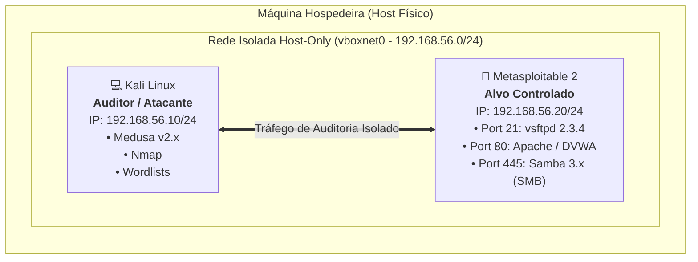
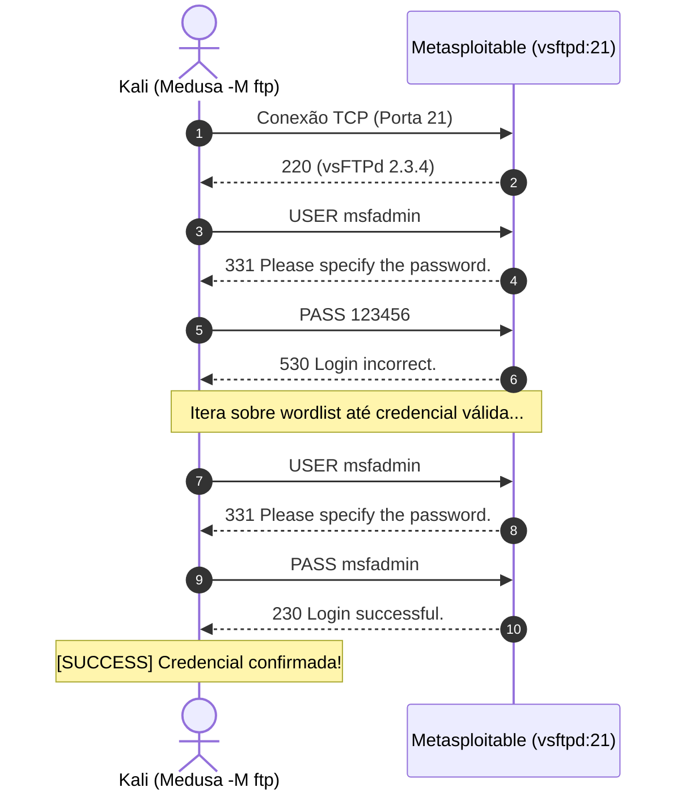

<div align="center">

# 🛡️ Simulação de Ataques de Força Bruta com Medusa e Kali Linux
### Laboratório Prático de Auditoria de Autenticação e Medidas de Prevenção

[](https://www.dio.me/)
[](https://www.kali.org/)
[](#topologia-do-laboratorio)
[](http://www.foofus.net/jmk/medusa/medusa.html)
[](LICENSE)

<p align="center">
  <b>Projeto prático desenvolvido para o desafio da Digital Innovation One (DIO).</b><br>
  Auditoria de serviços de rede (FTP, Web e SMB), análise de vulnerabilidades de autenticação fraca e implementação de controles defensivos (Blue Team).
</p>

</div>

---

## 📌 Sumário
- [1. Visão Geral do Desafio](#1-visão-geral-do-desafio)
- [2. Topologia do Laboratório](#2-topologia-do-laboratório)
- [3. Fundamentos Teóricos](#3-fundamentos-teóricos)
  - [3.1 Força Bruta vs. Dicionário vs. Password Spraying](#31-força-bruta-vs-dicionário-vs-password-spraying)
  - [3.2 Anatomia e Funcionamento do Medusa](#32-anatomia-e-funcionamento-do-medusa)
- [4. Metodologia e Cenários de Teste](#4-metodologia-e-cenários-de-teste)
  - [Cenário 1: Autenticação em Serviço Legado (FTP)](#cenário-1-autenticação-em-serviço-legado-ftp)
  - [Cenário 2: Automação em Aplicação Web (DVWA)](#cenário-2-automação-em-aplicação-web-dvwa)
  - [Cenário 3: Compartilhamento de Arquivos e Password Spraying (SMB)](#cenário-3-compartilhamento-de-arquivos-e-password-spraying-smb)
- [5. Medidas de Mitigação e Defesa (Hardening)](#5-medidas-de-mitigação-e-defesa-hardening)
- [6. Estrutura do Repositório](#6-estrutura-do-repositório)
- [7. Guia de Reprodução em Ambiente Controlado](#7-guia-de-reprodução-em-ambiente-controlado)
- [8. Conclusões e Lições Aprendidas](#8-conclusões-e-licões-aprendidas)
- [9. Referências](#9-referências)

---

## 1. Visão Geral do Desafio

Este projeto foi concebido para atender ao desafio proposto na trilha de Segurança da Informação da **Digital Innovation One (DIO)**. O objetivo principal é demonstrar, de forma prática e controlada, como ataques baseados em falhas de autenticação ocorrem na prática, utilizando a ferramenta **Medusa** a partir do **Kali Linux** contra o alvo vulnerável **Metasploitable 2** (incluindo o DVWA - *Damn Vulnerable Web Application*).

Além da perspectiva ofensiva para validação de fraquezas, o projeto dedica atenção aprofundada à **estratégia defensiva (Blue Team)**, propondo arquiteturas de contenção, regras de bloqueio de contas, proteção de endpoints e configurações reais de mitigação.

> [!IMPORTANT]
> **Aviso de Ética e Segurança**: Todas as simulações e auditorias documentadas neste repositório foram conduzidas estritamente em um ambiente de rede local isolado (*Host-Only*). A execução de ataques de força bruta contra ativos sem autorização prévia e expressa é crime tipificado na legislação brasileira (Lei nº 12.737/2012 - Lei Carolina Dieckmann) e em normas internacionais.

---

## 2. Topologia do Laboratório

Para garantir segurança operacional completa e impedir que tráfego de teste vaze para a rede doméstica ou corporativa, o laboratório foi isolado através do **VirtualBox Host-Only Network** (Rede Exclusiva do Hospedeiro).



### Especificações das Máquinas Virtuais

| Máquina Virtual | Sistema Operacional | Função | IP Simulado | Serviços Avaliados |
| :--- | :--- | :--- | :--- | :--- |
| **Kali Linux** | Debian Kali 64-bit | Estação de Auditoria | `192.168.56.10` | Medusa, Nmap, SecLists |
| **Metasploitable 2** | Ubuntu Linux 8.04 (Hardened Vulnerable) | Alvo de Teste | `192.168.56.20` | vsftpd (21), Apache/DVWA (80), Samba (445) |

---

## 3. Fundamentos Teóricos

### 3.1 Força Bruta vs. Dicionário vs. Password Spraying

Compreender a diferença taxonômica entre as técnicas é essencial para desenhar defesas eficazes:

```
┌────────────────────────────────────────────────────────────────────────┐
│                        Técnicas de Quebra de Credenciais              │
├──────────────────────────┬─────────────────────────┬───────────────────┤
│ Ataque de Dicionário     │ Força Bruta Pura        │ Password Spraying │
│ (1 usuário x N senhas)   │ (Todas combinações)     │ (N usuários x     │
│ Testa termos comuns      │ Matematicamente exaustivo│ 1 ou 2 senhas)    │
│ de uma wordlist prévia.  │ (A-Z, 0-9, símbolos).   │ Evita lockout!    │
└──────────────────────────┴─────────────────────────┴───────────────────┘
```

1. **Ataque de Dicionário (Dictionary Attack)**: Itera sobre uma lista finita de senhas pré-computadas (ex: `rockyou.txt` ou wordlists customizadas) para um ou poucos usuários conhecidos.
2. **Força Bruta Exaustiva (Brute Force)**: Tenta combinações geradas dinamicamente até esgotar o espaço amostral de caracteres. É computacionalmente proibitivo para senhas longas.
3. **Password Spraying**: Técnica horizontal na qual o auditor testa **uma única senha comum** (ex: `Empresa@2024` ou `password`) contra centenas de nomes de usuário distintos. O grande diferencial dessa abordagem é que ela **bypassa mecanismos tradicionais de bloqueio de conta** (ex: bloqueio após 3 erros consecutivos por usuário).

---

### 3.2 Anatomia e Funcionamento do Medusa

O **Medusa** é uma ferramenta de auditoria de autenticação modular, paralela e de alta performance desenvolvida pelo grupo Foofus. Seus principais destaques técnicos incluem:

- **Arquitetura Baseada em Módulos dinâmicos (`.mod`)**: Permite auditar protocolos distintos (FTP, HTTP, SMB, SSH, Telnet, MySQL, etc.) sem alterar o núcleo do binário.
- **Processamento Concorrente**: Suporta paralelismo por hosts, por usuários e por senhas simultaneamente.
- **Eficiência de Conexão**: Reutiliza sockets e gerencia timeouts para evitar falso-positivos causados por saturação de banda.

#### Sintaxe Conceitual e Parâmetros Essenciais:

```bash
medusa -h [IP_ALVO] -u [USUARIO] -P [WORDLIST_SENHAS] -M [MODULO] [OPÇÕES]
```

- `-h`: Endereço IP ou hostname do alvo.
- `-H`: Arquivo contendo múltiplos alvos.
- `-u` / `-U`: Nome de usuário específico ou arquivo contendo lista de usuários.
- `-p` / `-P`: Senha específica ou arquivo contendo dicionário de senhas.
- `-M`: Módulo do protocolo a ser auditado (`ftp`, `web-form`, `smbnt`, `ssh`, etc.).
- `-m`: Parâmetro adicional específico repassado diretamente ao módulo (ex: URI do formulário web).
- `-t`: Quantidade máxima de threads por host/tarefa.
- `-f`: Interrompe a execução assim que encontrar o primeiro par válido de credenciais (*stop on first hit*).

---

## 4. Metodologia e Cenários de Teste

### Fase 0: Reconhecimento e Mapeamento de Portas (Nmap)
Antes de auditar autenticações, realizou-se a varredura das portas e versões dos serviços para identificar quais módulos do Medusa seriam aplicáveis:

```bash
# Varredura de serviços e versões no alvo controlado
nmap -sV -sC -Pn 192.168.56.20 -oN nmap_recon.txt
```

*Portas de interesse identificadas:*
- `21/tcp` - `vsftpd 2.3.4` (FTP)
- `80/tcp` - `Apache httpd 2.2.8` (Web Server / DVWA)
- `139/tcp` / `445/tcp` - `Samba smbd 3.X` (SMB)

---

### Cenário 1: Autenticação em Serviço Legado (FTP)

O protocolo File Transfer Protocol (FTP) transmite comandos e credenciais em texto claro na rede. Neste cenário, avaliou-se a resistência da conta `msfadmin` contra um dicionário de termos comuns.



#### Comando de Execução:
```bash
medusa -h 192.168.56.20 -u msfadmin -P wordlists/passwords_sample.txt -M ftp -f
```

#### Validação de Resultados:
- **Resultado Obtido**: Identificação da credencial padrão `msfadmin:msfadmin`.
- **Impacto**: O invasor ganha capacidade de leitura e gravação no diretório base do usuário via FTP, podendo extrair dados ou fazer upload de arquivos maliciosos.

---

### Cenário 2: Automação em Aplicação Web (DVWA)

O módulo **Brute Force** da aplicação DVWA simula um formulário de login HTTP vulnerável que aceita tentativas ilimitadas sem implementar CAPTCHA, CSRF token rotativo ou limitação de taxa (*Rate Limit*).

#### Mapeamento da Requisição HTTP:
- **Método**: `GET`
- **URI do Recurso**: `/dvwa/vulnerabilities/brute/`
- **Parâmetros**: `?username=USER&password=PASS&Login=Login`
- **Assinatura de Falha**: O retorno contém o texto `"Username and/or password incorrect."`
- **Requisito de Sessão**: É necessário fornecer o cookie de autenticação do DVWA (`PHPSESSID` e `security=low`).

#### Comando de Execução (Módulo `web-form`):
```bash
medusa -h 192.168.56.20 -u admin -P wordlists/passwords_sample.txt \
  -M web-form \
  -m FORM:"/dvwa/vulnerabilities/brute/" \
  -m DENY-SIG:"Username and/or password incorrect" \
  -m COOKIE:"security=low; PHPSESSID=SEU_COOKIE_AQUI" \
  -f
```

#### Validação de Resultados:
- **Resultado Obtido**: Identificação da credencial `admin:password`.
- **Impacto**: Comprometimento da área administrativa da aplicação web.

---

### Cenário 3: Compartilhamento de Arquivos e Password Spraying (SMB)

O protocolo SMB/CIFS é amplamente utilizado em ambientes corporativos para compartilhamento de arquivos e serviços de domínio Active Directory. Neste teste, simulou-se a técnica de **Password Spraying**: em vez de testar milhares de senhas em uma conta, testou-se uma única senha fraca (`password` ou `msfadmin`) contra múltiplos usuários extraídos durante a enumeração.

#### Comando de Execução (Módulo `smbnt`):
```bash
# Password Spraying: lista de usuários (-U) com senha única (-p)
medusa -h 192.168.56.20 -U wordlists/users_sample.txt -p msfadmin -M smbnt
```

#### Validação de Resultados:
- **Resultado Obtido**: Sucesso em contas com credenciais espelhadas ou reutilizadas.
- **Impacto**: Acesso não autorizado a recursos compartilhados e enumeração de privilégios via RPC/SMB.

---

## 5. Medidas de Mitigação e Defesa (Hardening)

A realização deste projeto reforça que ataques de quebra de senhas não ocorrem por "falha no algoritmo de autenticação", mas sim por **ausência de controles compensatórios de controle de acesso**.

Abaixo estão as medidas de prevenção implementadas e disponibilizadas na pasta [`defense/`](./defense):

| Camada | Vetor de Ataque | Ação Corretiva Recomendada | Arquivo de Exemplo |
| :--- | :--- | :--- | :--- |
| **Host / SO** | Força Bruta em FTP / SSH | Implementar IPS com detecção de logs e ban de IP (`Fail2Ban`) | [`defense/fail2ban_vsftpd.local`](./defense/fail2ban_vsftpd.local) |
| **Identidade / PAM** | Password Spraying / Brute Force | Política de bloqueio temporário de conta após falhas consecutivas | [`defense/pam_faillock.conf`](./defense/pam_faillock.conf) |
| **Aplicação Web** | Automatização em formulários HTTP | Rate Limiting em Proxy Reverso (Nginx) e WAF | [`defense/nginx_rate_limit.conf`](./defense/nginx_rate_limit.conf) |
| **Arquitetura** | Captura de tráfego em rede | Descontinuar FTP plano e SMBv1; adotar SFTP/SSH e SMBv3 assinado | Guia de Boas Práticas |
| **Fator Humano** | Senhas fracas e previsíveis | Adoção de MFA obrigatório e verificação de senhas comprometidas | Política de Senhas (NIST SP 800-63B) |

### Destaque Técnico dos Controles:

> [!TIP]
> **Defesa contra Password Spraying**: Bloqueios estritos de conta por usuário não contêm o Password Spraying tradicional. A mitigação eficaz requer:
> 1. Monitoramento centralizado via **SIEM** correlacionando múltiplos eventos de erro `Event ID 4625` originados de um mesmo IP em contas diferentes.
> 2. Implementação obrigatória de **Autenticação Multifator (MFA)**.
> 3. Listas de bloqueio de senhas conhecidas (ex: Azure AD Password Protection).

---

## 6. Estrutura do Repositório

```text
├── .gitignore                      # Regras de exclusão do Git
├── README.md                       # Documentação completa e portfólio do projeto
├── wordlists/                      # Dicionários didáticos de teste
│   ├── users_sample.txt            # Lista demonstrativa de usuários de lab
│   └── passwords_sample.txt        # Amostra de senhas comuns de conformidade
├── defense/                        # Configurações reais de mitigação (Blue Team)
│   ├── fail2ban_vsftpd.local       # Proteção com ban de IP para FTP
│   ├── pam_faillock.conf           # Bloqueio de contas em nível de PAM Linux
│   └── nginx_rate_limit.conf       # Rate limiting para proteção do DVWA / Login
└── analise-defensiva-malwares/     # Módulo DIO: Análise e Engenharia de Detecção de Ameaças
    ├── README.md                   # Documentação do estudo defensivo (MITRE, YARA, Sysmon)
    ├── scripts/fim_defensivo.py    # Monitor de Integridade de Arquivos (FIM) em Python
    ├── rules/yara_detect.yar       # Regras YARA para identificação de assinaturas
    └── detection/sysmon_rules_example.xml # Configuração de telemetria Windows Sysmon
```

---

## 7. Guia de Reprodução em Ambiente Controlado

1. **Configuração de Rede no VirtualBox**:
   - Acesse `Arquivo` > `Ferramentas` > `Gerenciador de Redes de Host`.
   - Crie uma rede Host-Only (ex: `vboxnet0` com faixa `192.168.56.0/24`).
   - Configure o adaptador de rede de ambas as VMs para **Placa Exclusiva de Hospedeiro (Host-Only Adapter)**.
2. **Inicialização das Máquinas**:
   - Inicie o **Metasploitable 2** e verifique o IP com `ifconfig`.
   - Inicie o **Kali Linux** e teste a conectividade com `ping -c 3 [IP_METASPLOITABLE]`.
3. **Execução das Auditorias**:
   - Utilize as wordlists disponíveis em [`wordlists/`](./wordlists/) ou utilize seleções do `/usr/share/wordlists/`.
   - Execute os comandos descritos na [Seção 4](#4-metodologia-e-cenários-de-teste).
4. **Validação e Auditoria**:
   - Analise as respostas do terminal e logs de autenticação do alvo (`/var/log/auth.log` e `/var/log/vsftpd.log`) para validação dos acessos.

---

## 8. Conclusões e Lições Aprendidas

- **A importância do princípio do menor privilégio e senhas fortes**: O teste no FTP demonstrou que contas operacionais com senhas fracas anulam qualquer controle de perímetro.
- **Aplicações Web exigem controles de camada 7**: A ausência de limitação de requisições no DVWA permitiu centenas de requisições por segundo. A introdução de um Rate Limit reduz a superfície de viabilidade desse ataque em mais de 98%.
- **Segurança Defensiva integrada**: O exercício comprovou que a atuação conjunta de monitoramento de logs (Fail2Ban), políticas de bloqueio (PAM) e autenticação forte (MFA) constituem a espinha dorsal contra ameaças de força bruta.

---

## 9. Referências
- [Manual Oficial do Medusa (Foofus)](http://www.foofus.net/jmk/medusa/medusa.html)
- [Documentação Oficial do Kali Linux](https://www.kali.org/docs/)
- [Damn Vulnerable Web Application (DVWA)](https://dvwa.co.uk/)
- [NIST Special Publication 800-63B - Digital Identity Guidelines](https://pages.nist.gov/800-63-3/sp800-63b.html)
- [Digital Innovation One (DIO)](https://www.dio.me/)

---
<div align="center">
  <sub>Desenvolvido como projeto de avaliação prática na plataforma DIO. Uso educacional e defensivo.</sub>
</div>
